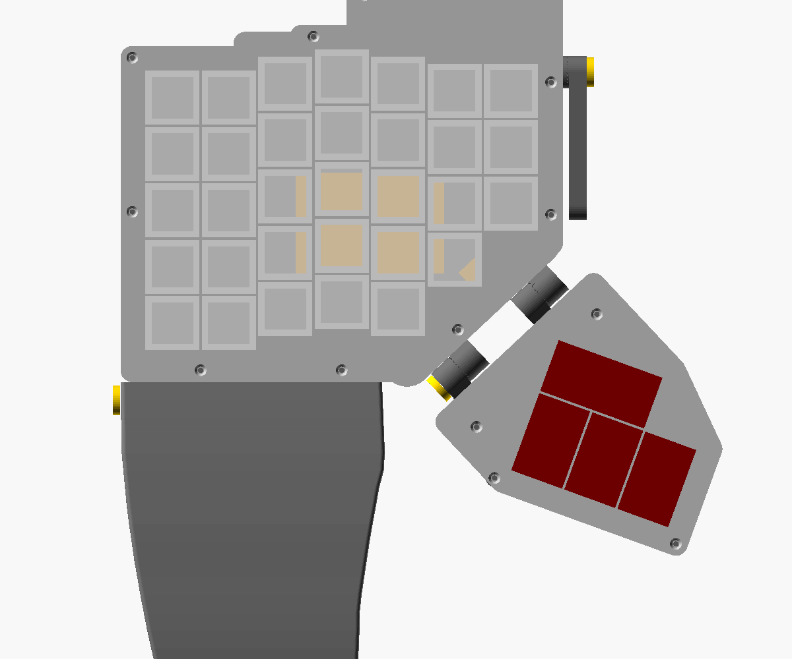
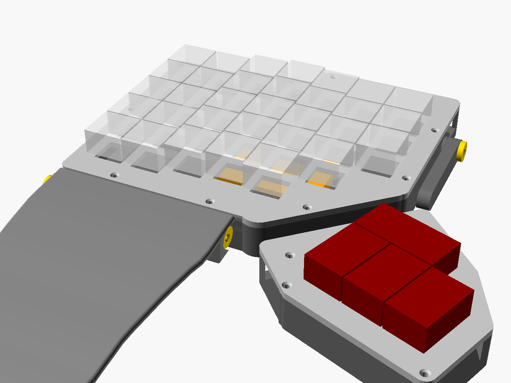
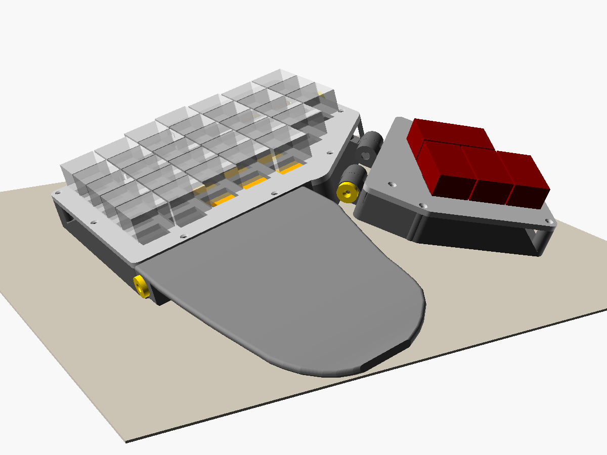
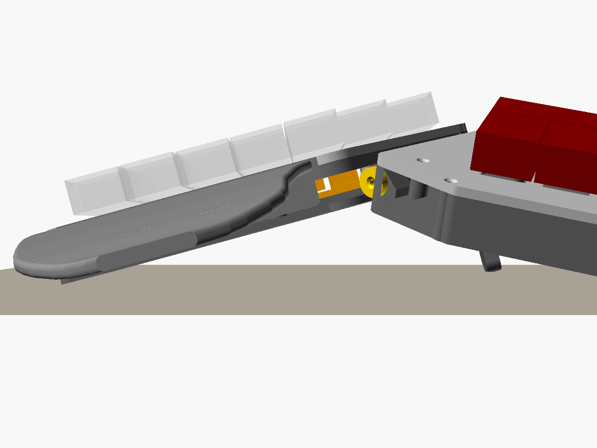
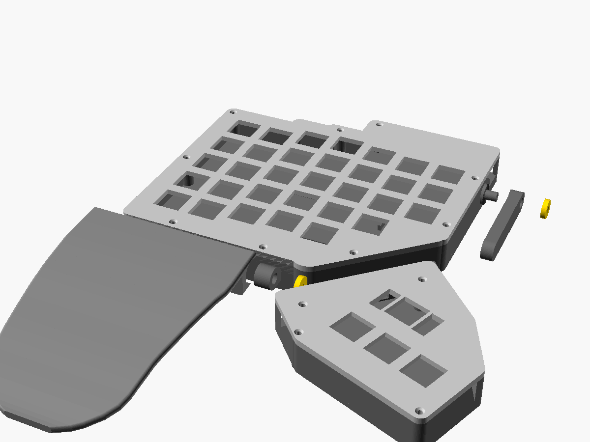

# Moon72: Moonlander clone (wireless, handwired)

A split board with ZSA Moonlander's key grid: 72 MX keys. Each half has 5 rows x 7 columns of main keys plus a thumb module (red key + 3 thumbs).

The layout is taken from qmk `keyboards/zsa/moonlander/keyboard.json`: same column stagger, same key order. Moonlander keymaps transcribe 1:1.

Differences from the real Moonlander:
- nice!nano v2 + ZMK in each half, over Bluetooth. No cable between the halves.
- Handwired in a printed case.
- No RGB, no hotswap, no indicator LEDs.

Kept from the Moonlander:
- The thumb module tilts on a hinge (printed, toothed: 15° steps).
- Tenting the Moonlander way: a swing-down leg on the inner wall, and the thumb module tilted down to the desk as the second support.
- The wing: a palm rest on a free hinge along the front edge. It lies on the desk and follows the board.

Hardware is **M2 x 8 countersunk screws only** (17 per half). The hinges and the leg are printed.







## Parts per half

```
   plate         32 switch holes + a solid lid over the top strip; nice!nano glued under it
     |           9 x M2 countersunk down into the tray
   tray          floor + walls. USB-C notch (inner wall), switch notch (top wall), battery fence,
                 2 thumb hinge knuckles, 2 wing knuckles (front wall), toothed leg pivot (inner wall).
                 Notches are open at the top: the wired plate drops in
   thumb_plate   red key (2u cap, plate-mount stab) + 3 thumbs (1.5u caps); 4 x M2 into the thumb tray
   thumb_tray    floor + walls + 2 toothed hinge knuckles
   palm          the wing: wrist rest on 2 knuckles, swings freely
   leg           tenting arm, toothed hub; swings down from along the inner wall
   hinge_cap     4 per half (1 thumb hinge, 2 wing, 1 leg): washer over a boss end, 1 x M2 each
```

### Hinges

The thumb module, the wing and the leg all use the same hinge unit:
- A knuckle on each part.
- A printed 5 mm boss on one part, running through the other part's knuckle.
- A printed cap over the boss end, on the outside, pulled in by one M2 x 8 screwed into the boss.

The thumb hinge and the leg have toothed faces between the knuckles: 24 teeth, so 15° steps. The wing has plain faces: the screw only sets how stiffly it swings.

The thumb module and the wing each have two units, one at each end of their edge, and both units point the same way:
- **Outer unit:** the boss is on the tray and goes through the moving part's knuckle.
- **Inner unit:** the boss is on the moving part and goes into the tray's knuckle.

So each part goes on by sliding along its hinge axis, from the outer side, onto both bosses at once (`assembly.png`). Every cap ends up on an outside end, where a screwdriver reaches it.

The thumb hinge's inner unit is different: its "boss" is a hollow tube (6.4 mm, 4.4 mm inside) that carries the thumb wires, and it has no screw. It doesn't need one: the outer unit's screw pulls the whole module inward, which presses both sets of teeth together.

### Thumb module

It hinges along the staircase under columns 4-6. To change the angle: loosen its one M2 (outer end) about two turns, slide the module about 1 mm outward so the teeth come apart, tilt it to the next step (0, 15, 30 or 45°), push it back in and tighten. It tilts its outer edge down.

### Tenting

Like the Moonlander, the board stands on three points: its outer edge, the leg (inner side, toward the back) and the thumb module (inner side, front).
1. Loosen the leg's M2 about two turns and pull the arm out a little so its teeth come apart.
2. Swing it down to the angle you want and tighten. Stowed, it lies flat along the inner wall, pointing forward.
3. Tilt the thumb module down until it rests on the desk.

| Leg angle | 0° (stowed) | 15° | 30° | 45° | 60° | 75° | 90° (straight down) |
|---|---|---|---|---|---|---|---|
| Tent | flat | 3° | 7° | 11° | 13° | 15° | 15° |

At 90° the thumb module rests on the desk at its 30° step (0.3 mm off it in the model).

### Wing (palm rest)

The wing has the Moonlander's shape, traced from ZSA's official `moonlander-outline.stl` ([zsa.io/moonlander/printables](https://www.zsa.io/moonlander/printables)):
- **Outline:** 121 mm deep and 88 mm wide at the back, tapering to a blunt round tip that sits toward the outer side.
- **Shell:** curved, 3.5 mm thick. It starts at the plate's height at the back and curves down, more steeply toward the front, until the tip touches the desk.
- **Hinge strip:** a 15 mm solid strip along the back edge holds the knuckles.

It hangs on two knuckles under its back edge, axis just in front of the tray's front wall. It swings freely:
- **Board flat:** the tip rests on the desk. Its back edge sits square and flush against the tray, 1 mm below the plate top. The wall stops it there, so it can't fold up.
- **Board tented:** it tents with the board, resting on its outer edge, like the Moonlander's.
- **Board's front raised:** it tips front-down, up to 30°, with its front still on the desk.
- **Transport:** there's no magnet stow. To take it off, take out its two M2 and slide it off toward the outer side.

The halves are 149 x 136 mm (main), 77 x 102 mm (thumb module) and 88 x 121 mm (wing). Everything fits the P1S bed.

## Bill of materials (both halves)

<!-- BOM: written by wiring/build.py, edit the BOM list there -->
| Part | Qty | Notes | Buy |
|---|---|---|---|
| **Electronics** | | | |
| nice!nano v2 | 2 | already have. One per half. If you ever need another: the linked board is a Pro Micro-format nRF52840 (the usual nice!nano v2 clone), but its listing doesn't say nice!nano: before soldering, check it has B+ and B− battery pads and that its pin labels match the pinout below (ZMK board `nice_nano_v2`) | [robu.in: Promicro nRF52840](https://robu.in/product/promicro-nrf52840-development-board/) |
| MX switches (3-pin or 5-pin) | 72 | 36 per half. 5-pin ones: clip the two plastic legs (plate mount) | [StacksKB: switches](https://stackskb.com/product-category/switches/) · [Meckeys: switches](https://meckeys.com/category/accessories/keyboard-accessories/key-switches/) |
| 1N4148 diode, through-hole (DO-35) | 72 | one per key. Not the SMD (SOD-323/SOD-123) ones | [robu.in: 1N4148 DO-35](https://robu.in/product/1n4148pf-semtech-do-35-switching-diodes-rohs/) |
| LiPo KP-523450 (5.2 × 34 × 50 mm), with connector | 2 | sold as 2000 mAh; a cell this size really holds ~1000 mAh. Lies on the tray floor under the keys, in a fence sized for it, 0.3 mm under the switch pins: nothing thicker fits. The listing doesn't mention a protection circuit: check for a small board under the tape at the lead end and don't use a cell without one. The connector type isn't stated (probably JST-PH 2.0): the harness end needs the mating half. Check polarity before plugging in. Your HCY-502030 also fits: set `batt = [30, 20, 5]` | [Amazon.in: KP-523450 with connector](https://www.amazon.in/dp/B0GQSXK3YX) |
| SS12D10G5 slide switch | 2 | already have. In battery +; hangs under the plate's top strip, lever out of the top wall | [robu.in: SS12D10G5](https://robu.in/product/ss12d10g5-shou-han-direct-insert-2a-single-pole-double-throw-spdt-125v-3000-times-plugin-slide-switches-rohs/) |
| 6 × 6 × 5 mm tact switch, through-hole | 2 | reset, pressed with a pin through the floor | [robu.in: 6×6×5 mm tact switch](https://robu.in/product/6x6x5-tactile-push-button-switch/) |
| Thumb link: JST XH 2.54 mm 5-pin plug + socket, both with 300 mm 26 AWG leads | 2 pairs | one pair per half. Lies flat in a pocket in the tray floor against the hinge wall. The socket's leads are the 5 wires through the hinge tube (cut to length); the plug's leads go to the harness. One pack is 4 pieces: if that means 2 plugs + 2 sockets it's exactly enough, else get 2 | [robu.in: 5-pin JST XH plug + socket with cable (4 pcs)](https://robu.in/product/5-pin-jst-xh-2-54mm-pitch-plug-and-socket-with-cable-4-pcs/) |
| **Keys** | | | |
| Keycaps | 64 × 1u, 6 × 1.5u, 2 × 2u | 1.5u on the thumbs, 2u on the red keys. Or 1u everywhere: set `thumb_h = 1`, `red_w = 1` | [StacksKB: keycaps](https://stackskb.com/) · [Meckeys: keycaps](https://meckeys.com/category/accessories/keyboard-accessories/keycaps/) |
| 2u plate-mount stabiliser | 2 | red keys; not needed with a 1u cap there | [StacksKB: Cherry plate-mount 2u](https://stackskb.com/store/genuine-cherry-mx-plate-mount-stabilizers-2u/) |
| **Wire and sundries** | | | |
| Solid copper wire, 24 AWG (0.5 mm) | ~4 m | row and column buses. Bare tinned is easiest; solid-core PVC wire with the insulation stripped off works the same | [robu.in: 24 AWG solid core (strip it)](https://robu.in/product/24-awg-solid-core-insulated-wire-pvc/) |
| Silicone wire, 28 AWG, stranded, 2 colours | ~6 m total | harness to the nice!nano, power, reset: 27 wires per half, ~10 cm each. Two colours (rows / columns) make it much easier to trace | [robu.in: 28 AWG black](https://robu.in/product/high-quality-ultra-flexible-28awg-silicone-wire-1000-m-black/) · [blue](https://robu.in/product/high-quality-ultra-flexible-28awg-silicone-wire-1000m-blue/) · [white](https://robu.in/product/high-quality-ultra-flexible-28awg-silicone-wire-1000m-white/) |
| Heat-shrink, 2.5 mm | ~1 m | already have. Cut into ~5 mm sleeves wherever a row bus crosses a column bus (~50 crossings) | [robu.in: 2.5 mm black heat-shrink](https://robu.in/product/heat-shrink-sleeve-2-5mm-black-industrial-grade-woer-hst/) |
| Insulating tape (Kapton or PVC) | 1 roll | under and around the nice!nano. Not copper-foil "high temperature" tape: it conducts | [robu.in: PVC insulation tape 19 mm](https://robu.in/product/electrical-insulation-multicomp-pro-pvc-tape-1920bl-pvc-polyvinyl-chloride-blue-19-mm-x-20-m/) |
| Hot glue |  | already have. nice!nano, switch, reset button; strain relief at the hinge slots | [robu.in: glue sticks](https://robu.in/product/all-purpose-hot-melt-glue-sticks-for-glue-gun-5pcs/) |
| Rubber feet, self-adhesive | ~8 | under the trays and the leg foot (any small bumpers) |  |
| **Hardware** | | | |
| M2 × 8 countersunk screw | 34 | 17 per half: 9 plate to tray, 4 thumb plate to thumb tray, 1 thumb hinge, 2 wing hinge, 1 tenting leg. They cut their own thread in 1.8 mm printed pilots: no inserts, no nuts. 2 packs of 25 | [robu.in: M2 × 8 CSK, 25 pcs](https://robu.in/product/easymech-ss-304-csk-countersunk-philips-head-m2-x-8-mm-bolt-25-pcs/) |
| **Printed (case/3mf/moonlander.3mf, PLA)** | | | |
| plate, tray, thumb_plate, thumb_tray | 1 each per half | trays with supports (hinge bosses lie sideways) |  |
| palm (the wing) | 1 per half | prints standing on its back edge, with a brim and supports |  |
| leg (tenting arm) | 2 | same part for both halves |  |
| hinge_cap | 8 | 4 per half: 1 thumb hinge, 2 wing, 1 leg |  |
| fit_plate | 1 | print first: switch fit and M2 bite |  |
| **Tools** | | | |
| Soldering iron, flush cutters, multimeter, glue gun |  |  |  |
| Screwdriver for your M2 heads |  | already have. PH0 for the Phillips ones linked above (1.3 mm hex key for hex-socket ones) | [robu.in: Stanley PH0 screwdriver](https://robu.in/product/stanley-stmt60802-8-cushion-grip-screwdriver/) |
<!-- /BOM -->

## Matrix and pins

Full wiring diagram: `wiring/wiring.html` (regenerate with `wiring/build.py`, which reads the geometry from `case/scad/moonlander.scad`).
- One drawing with both halves side by side, each seen from below, to scale, main plate and thumb plate together: bare row and column buses, every diode, and the 27 numbered wires per half to the nice!nano, the thumb-link connector, battery, switch and reset. The thumb wires are drawn running into the inner hinge.
- Also on the page: the bill of materials, a harness table, both halves' nice!nano pinouts (the board is not mirrored, so its D1-D9 header faces the keys on the left half and the back wall on the right), a wiring checklist, step-by-step assembly with the model renders, and meter tests.
- Click a part, bus or wire number to see only its wires.
- Switches all go in pins toward the back, except the red key, which is turned round (pins toward the thumbs) so row 5 runs straight.

Both halves use the same pins: 6 rows x 7 columns, `col2row`. Each diode's anode goes on the switch, with the **band toward the row wire**. Column pins follow the finger, so the right half's columns are a mirror image of the left's.

| Column | pinky outer | pinky | ring | middle | index | index inner | innermost |
|---|---|---|---|---|---|---|---|
| nice!nano pin | D21 | D20 | D19 | D18 | D15 | D14 | D1 |

| Row | pin | keys |
|---|---|---|
| 0 | D4 | number row (7 keys) |
| 1 | D5 | top (7) |
| 2 | D6 | home (7) |
| 3 | D7 | bottom (6, no innermost) |
| 4 | D8 | bottom-most (5, pinky outer to index) |
| 5 | D9 | thumb module |

Thumb module (row 5):
- Red key: middle column (D18).
- Thumbs, outermost first: D15, D14, D1.

That makes 5 wires across the hinge: row 5 plus those 4 columns. Use stranded silicone wire there, not solid.

Thumb link:
- Route: the wires run inside the inner thumb hinge, along its axis, like the Moonlander's ribbon cable crosses at its hinge. From the thumb plate they go into a slot in the thumb tray's inner knuckle, along the hollow tube, and out through a slot in the tray's knuckle. Then comes the JST XH connector (in a pocket in the tray floor) and the main harness. Nothing shows from outside, and there are no hoods.
- Tilting: the wires sit on the axis, so tilting 0-45° only twists them a little over ~10 mm. Their length doesn't change, so no slack loop is needed. `clash_wire` checks a 3 mm bundle along the path at every hinge step.
- Wire: the connector's own 300 mm, 26 AWG leads, 5 of them (about 1.3 mm each; they go through the 4.4 mm tube and lie 3 + 2 in the slots).
- Connector: the mated pair lies on its side against the inside of the hinge wall, next to the tray knuckle's slot, pushed in between the wall and a printed rail. The plug can't pass the tube, so it always stays in the tray. To take the module off: plate off, unplug, take out the thumb hinge screw, slide the module off toward the outer side; the leads come with it, through the tube.

Free pins: D0, D2, D3 (I2C pair), D16 and D10 (NFC pins; they need config before they work as GPIO).

Power:
- Battery + runs through the slide switch to B+, and battery − to GND.
- Reset goes across RST and GND.

## Build order

1. Print the paper template first. `case/layout_left.svg` is 1:1: print it at 100 % (mirror it for the right hand) and check the thumb reach. Tune `thumb_rot`, `thumb_s0`, `thumb_off` and `hinge_drop` in `moonlander.scad`, then re-run `case/build.sh`.
2. Print `case/stl/fit-tests/fit_plate.stl`:
   - The switches should click in firmly. If not, change `switch_cut` in `common.scad`.
   - An M2 should bite in the pilot. If not, change `pilot_d`.
3. Print. **`case/3mf/moonlander.3mf`** is one Bambu Studio project with every part of both halves (21) on 4 plates. Each part is already in its print orientation and clear of the P1S's front-left cutter zone. Settings: P1S 0.4, 0.20mm Standard, Textured PEI 65/60 °C, PLA Basic (from the macropad). The trays, thumb trays and wings have supports on (tree, build plate only), for the hinge bosses. Not sliced again since the hinge/leg/wing rework; the last slice (2026-10-10, old design) was about 9 h and 323 g for everything.

   Print the fit plate on its own first: in Bambu Studio, move it to a new empty plate and print only that one. `case/make_3mf.py` rebuilds the project from the STLs (`build.sh` runs it). The individual STLs are in `stl/left/`, `stl/right/`, plus `leg.stl` x2 and `hinge_cap.stl` x8. Orientation:
   - `plate` and `thumb_plate`: keycap side down. On the main plate the nice!nano blocks then face up.
   - `tray`: floor down, supports under the hinge bosses and the leg boss (they lie sideways).
   - `thumb_tray`: floor down, supports under its hinge boss and wire tube.
   - `palm` (the wing): standing on its back edge, the shell rising almost vertically. Supports (on, build plate only) for the hinge boss in its inner pocket. Use a brim: it stands on a 7 mm strip.
   - `leg`: cap face down, teeth up.
   - `hinge_cap`: as exported.
4. Wire the plate and thumb plate upside down:
   - Diodes, rows, columns.
   - The thumb link: tray-side half of the JST XH pair on the main harness. The module-side half's leads stay loose at the thumb end for now; they go through the hinge first (step 6).
   - The harness to the nice!nano, which sits upside down between the two blocks under the top strip with its USB-C toward the inner edge. Hot glue it.
   - The battery lead (JST-PH) through the slide switch to B+.
   - Reset button across RST/GND.
5. Flash and test every key before closing anything.
6. Assemble:
   - Thumb link through the hinge, with both plates off:
     1. Plug the two halves of the JST XH pair together and lay the pair flat in its pocket in the tray floor, against the hinge wall.
     2. Push its 5 bare leads out through the slot in the tray's inner hinge knuckle, so they come out of the knuckle's bore.
     3. Thread them into the end of the thumb tray's tube, along it, and out through its slot into the thumb tray.
   - Thumb hinge: hold the thumb tray level with the tray, off to the outer side along the hinge, and slide it in along the hinge, taking up the leads' slack. Its outer knuckle goes onto the tray's boss and its tube goes into the tray's inner knuckle, both at once. Push until the teeth mesh at the angle you want. One cap on the outer end, 1 x M2 x 8 into the boss.
   - Solder the leads to the thumb plate (row 5, red key and thumb columns).
   - Main: battery in its fence, plate into the tray, 9 x M2.
   - Thumb: thumb plate onto the thumb tray, 4 x M2.
   - Wing: the same way. Hold it in front of the tray, off to the outer side, and slide it in along the front edge. Its outer knuckle goes onto the tray's boss, and its boss goes into the tray's inner lug. Cap on each end, 1 x M2 each. Tighten until it swings stiffly but still drops under its own weight.
   - Leg: arm onto the boss on the inner wall, teeth meshed, stowed (pointing forward along the wall). Cap, 1 x M2.

## Firmware

ZMK config is in `firmware/zmk-config`:
- Shield `moon72`: physical layout from the QMK coordinates, so ZMK Studio shows a Moonlander.
- Keymap `config/moon72.keymap` is the stock Moonlander default (Base / Symbols / Media).
  - RGB / Oryx keys are `&none`.
  - Media gets Bluetooth profiles, USB/BLE output toggle, bootloader on both outer top corners, and the Studio unlock key.
- The left half is central and has ZMK Studio.

How to build:
- **Locally:** `firmware/build.sh` writes `firmware/uf2/`. It uses the `~/zmk-config-klor` workspace + the `zmk-build-arm:3.5` image, like the dactyl. Built OK 2026-10-10.
- **GitHub Actions:** push `firmware/zmk-config` as its own repo.

How to flash:
1. Double-tap reset. The board mounts as `NICENANO`.
2. Copy `moon72_left.uf2` / `moon72_right.uf2` to the matching half.
3. If the halves won't pair: flash `settings_reset.uf2` to both halves, then reflash both.

## Case (case/)

`case/build.sh` does three things in about 4 min:
- Runs the clash checks:
  - keycaps vs thumb caps at every tilt;
  - thumb module vs tray/plate/wing/leg from 0 to `tilt_max`;
  - electronics vs switches/walls/plate;
  - wing over its 0-30° swing;
  - leg over its whole turn;
  - thumb module and wing sliding on during assembly;
  - the thumb wires' path through the inner hinge at every tilt.
- Renders every STL.
- Writes the paper template and previews.

Everything is in `scad/moonlander.scad`, with the parameters at the top. `common.scad` has the switch hole (from the dactyl/macropad) and the M2 screw values.

Height: the plate top is 18.5 mm off the desk, enough for the 5 mm battery under the switch pins. Thinner battery: lower `plate_top`, and `clash_tray` will tell you if it no longer fits.

## Not yet checked on real parts

- Thumb module position. Its geometry is my own (hinge along the col 4-6 staircase), not measured from a real Moonlander. Check it with the paper template.
- The wire tube: 1 mm wall, printed lying down on supports. Check it comes out round enough to turn in its bore (`tube_cl`), and that 5 wires thread through (`tube_id`).
- One screw for both thumb hinge units: if the inner teeth don't seat when the outer screw is tight, the outer unit alone holds the angle. The inner teeth are short (the tube bore takes their middle).
- Hinge teeth (0.8 mm, 24 per face) and how well one M2 per hinge holds them under thumb presses. If they slip: `teeth` lower and `tooth_h` higher.
- The leg: one M2 and 11 mm teeth hold your wrist's weight, with the most torque at 30-60° (at 90° it carries load straight down). It may slip there.
- How stiffly the wing swings with plain printed faces (`face_cl`), and whether the wing stays put while you rest on it.
- The bosses lie sideways on the tray and thumb tray, so they print on supports. Check they come out round enough to turn in their bores (`pin_cl`).
- M2 bite in the 1.8 mm pilots (`pilot_d`).
- Red key stab cutout position (Cherry plate-mount numbers, untested).
- 2u red cap / 1.5u thumb caps: taken from the QMK layout's key sizes; ZSA's actual caps may differ.
- Wing height at the back (`palm_drop`), shell thickness (`wing_t`): 3.5 mm PLA spanning ~110 mm between the hinge and the tip.
